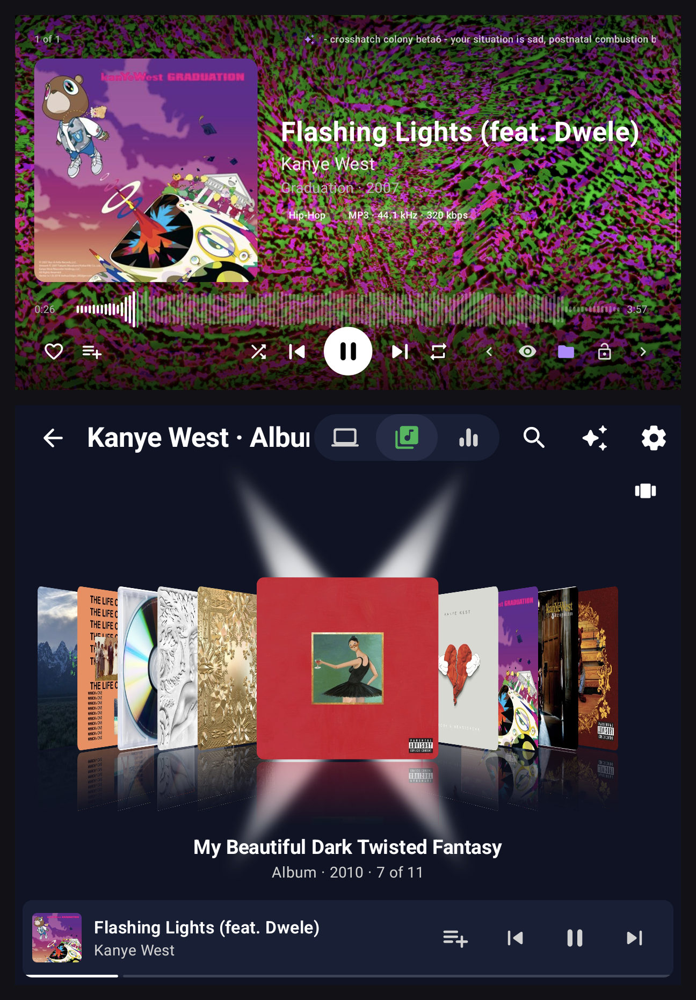
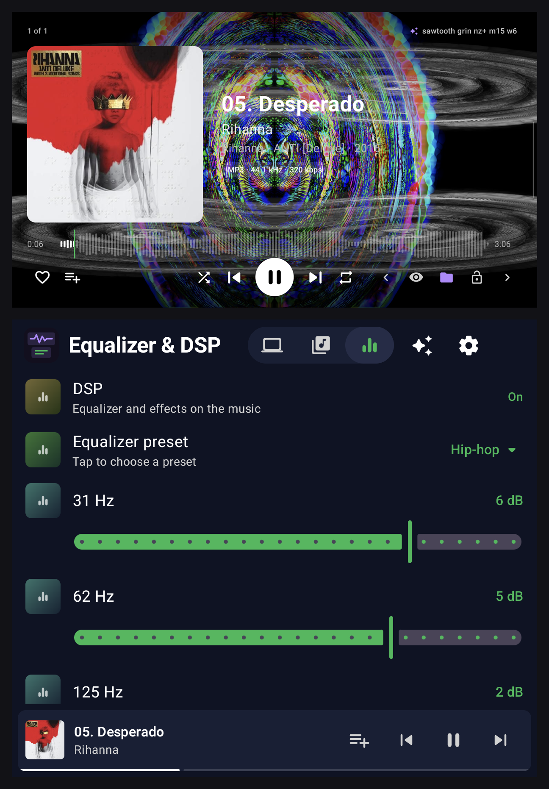
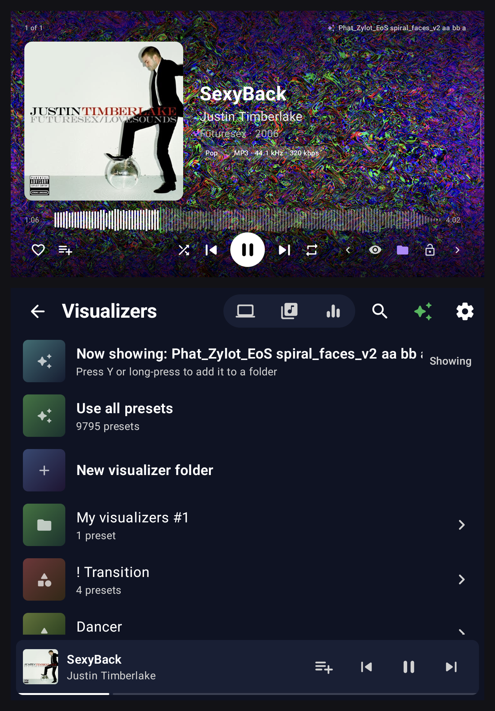
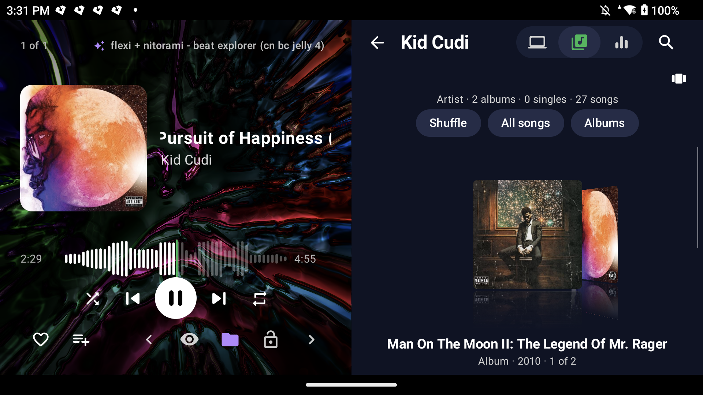
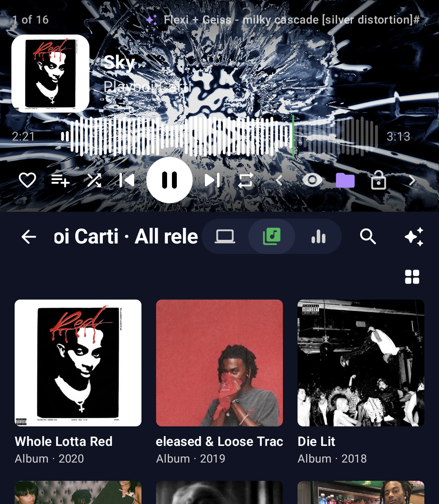
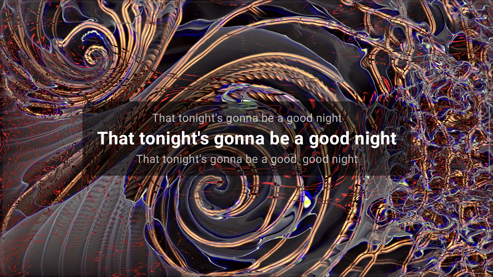

# DualAmp

A music player made with the **AYN Thor** and its two screens in mind. It works on single-screen Android devices
(phones, tablets, other handhelds) as well: there it puts everything on one screen.

- **Top screen:** now playing. A full-screen MilkDrop visualizer with album art, title, artist, album, year,
  genre, format, a waveform seek bar and controls on top of it. The info fades out after a few seconds (or never),
  leaving just the visualizer. Tap the screen (or press any controller button) to bring it back.
- **Bottom screen:** your library, laid out like Spotify's: category chips (Playlists, Artists, Albums, Singles, Songs,
  Genres, Years, Folders, Queue), a sort menu, and three views: **List, Grid and Cover Flow**. Drill-down works like an
  iPod: Artist → their albums and singles → tracks. Long names scroll so you can read all of them.

**Version 1.3** · made by njrozen and Claude.

| Both screens: now playing on top, the library below (here in Cover Flow) |
|:---:|
|  |

| Equalizer | Visualizers |
|:---:|:---:|
|  |  |

| Single-screen on the top screen (landscape) | Single-screen on the bottom screen (portrait) |
|:---:|:---:|
|  |  |

| Lyrics over the visualizer (top screen) |
|:---:|
|  |

## Screens, landscape and portrait

- **Settings > Use both screens** chooses how DualAmp uses the Thor's screens:
  - **Both Screens** (default): now playing on the top screen, the library on the bottom one.
  - **Top Screen** or **Bottom Screen**: single-screen mode, with now playing and the library together on that screen.
- **Single-screen mode** is also what you get on a device with one screen, and when you open DualAmp from the bottom
  screen's launcher or as a Cocoon companion app (Settings then shows Bottom Screen). In landscape the player and the
  library sit side by side; in portrait the player is on top and the library below.
  **Settings > Swap sides (single-screen)** puts the library on the left (landscape) or on top (portrait). The grid has
  its own size in single-screen mode (3 per row by default).
- **Settings > Swap screens** is for devices whose screens open the wrong way round (both-screens mode).
- **Settings > Screen orientation:** Auto (follows how you hold the device), Landscape or Portrait (either way up).
  Both screens always turn together. In portrait the D-pad turns with the screen, so up on the D-pad is always up on
  screen.

## What's new in 1.3

- **Single-screen tabs layout** (Settings > Screens > Single-screen layout: Tabs), like Spotify: the library with its tabs at the bottom
  or top and a player bar; tap it (or double-click L3) for the big player, close it with its back arrow or B. Swipe the cover to skip.
  See [Single-screen tabs layout](#single-screen-tabs-layout).
- **Multiple artists:** songs with several artists ("A, B", "A feat. B", "Song (feat. B)") are listed under each, with **Appears on**
  on artist pages; the separators and the names never to split are editable. See [Multiple artists](#multiple-artists).
- **Mp3tag actions** for tidying multi-artist tags (`DualAmp-Mp3tag-actions.zip` on the release page).
- **Lyrics from the internet** show a small cloud next to the lyrics button.
- **Controls:** Select from Visualizers or Settings goes back to the tab you were in.
- **Fix:** the About box fits narrow screens (single-screen side by side in landscape).

## What's new in 1.2

- **Lyrics:** timed lyrics over the visualizer and in the song info, from `.lrc` files next to your songs, the songs' tags, or
  lrclib.net. The lyrics button (top left of the player) or a double-click of the right stick turns them on and off; Settings > Lyrics
  sets the background darkness and the timing (sooner / later). Songs without lyrics just show the visualizer.
- **Stream the visualizer** to a TV, PC or phone browser on the same Wi-Fi (Settings > Stream visualizer).
- **Hold Y** to like the song playing or add it to a playlist, from anywhere.
- **Lid closed:** the buttons work with the music paused too, the visualizer stops to save battery, the volume buttons keep
  controlling DualAmp, and it works alongside SleepManager's closed-lid protection.
- **Cover Flow:** the glow pulses as you move through the covers.
- **Fixes:** waveforms load for every song; the artist page's buttons fit narrow screens.

## What's new in 1.1

- **Screens:** Both Screens / Top Screen / Bottom Screen, single-screen mode in landscape and portrait, Swap sides,
  and both screens turning together (Auto, Landscape or Portrait). The single-screen player fits its half of the
  screen, and long titles, artists and visualizer names scroll.
- **Library views:** List, Grid and Cover Flow on every page. One view everywhere, or separate views for the
  categories and the pages inside them; the view to start with; grid size 3-6 per row.
- **Looks:** themes (Default, Light, OLED black, Midnight) with an accent color, and a Cover Flow glow behind the
  selected cover (color, shape, strength and how it appears).
- **Controls:** L3 changes the library view (hold to clear the queue); hold R2 / L2 to fast forward / rewind, also
  with the lid closed; L2 can pick a random visualizer.
- **Volume on the Thor:** both screens use the top screen's volume; single-screen mode uses the volume of the
  screen DualAmp is on.
- **Other:** song info fades after 3-30 s or never; Visualizer reactivity setting; quitting DualAmp stops the music;
  waveforms now load for every song; settings are grouped into sections.

## Installing

Download from the [latest release](https://github.com/njrozen/DualAmp/releases/latest): **DualAmp-1.3.apk** (the app) and,
optionally, **DualAmp-Server.exe** (for playing your PC's music) and **DualAmp-Mp3tag-actions.zip** (for tidying
artist tags, see [Multiple artists](#multiple-artists)).

1. Copy `DualAmp-1.3.apk` to the Thor (or any Android 11+ device) and open it (allow installing from your file manager when asked), or from a PC:
   `adb install DualAmp-1.3.apk`. It installs over earlier versions and keeps your settings and playlists.
2. Start DualAmp. It asks for your music folder, offers the shoulder-button permission, then shows the help guide
   (Settings > Help opens it again).
3. Optional, for the lid-closed buttons: Settings > Lid-closed buttons, and turn on DualAmp under
   Accessibility (Settings > Shoulder buttons while asleep).
4. Optional, to play the music on your Windows PC over Wi-Fi: run `DualAmp-Server.exe` on the PC and choose your music in its window (see
   [Playing music from your PC](#playing-music-from-your-pc)).

## Building

Requirements: Android Studio (its bundled JDK is fine), Android SDK 36, NDK 28.2.13676358, CMake 3.31.6.
All of these can be installed from Android Studio's SDK Manager.

1. *(Optional, recommended)* Bundle ~9,800 MilkDrop presets plus the texture pack:
   ```
   powershell -ExecutionPolicy Bypass -File tools\fetch-presets.ps1
   ```
   Without this, the app starts with no presets. You can still import your own from Settings.
2. Open the folder in Android Studio and run it, or build from a terminal:
   ```
   gradlew assembleDebug
   ```
   The APK is written to `app/build/outputs/apk/debug/app-debug.apk`.
3. Install it on the Thor: `adb install -r app/build/outputs/apk/debug/app-debug.apk`

## Controls

| Input | Action |
|---|---|
| Tap top screen | Show or hide the song info |
| Swipe left/right on the visualizer, or its arrow buttons | Next / previous preset in the visualizer folder you are using (wraps round) |
| D-pad | Move the library cursor (left/right switch categories at the top level, left goes back elsewhere). Up from the top row reaches the categories (Playlists, Artists, Albums, Singles, Songs, Genres, Years, Folders, Queue; left / right switch) and then the header: PC, Library, Equalizer, search, visualizers, settings (A picks, down goes back) |
| A | Open / play |
| B | Back |
| Y (or long-press) | Item menu: play next, add to queue, add to playlist, like, go to album/artist. Hold Y: like the song playing or add it to a playlist |
| X / R2 | Play / pause (R2 also works asleep, see below). Hold R2: fast forward |
| Start | Settings (press again to close); hold for the visualizer folders |
| L1 / R1 | Previous / next track (also asleep) |
| L2 | Next visualizer, or a random one from the folder (Settings > L2 button). Hold: rewind |
| Playlist button (next to Like, top screen) | Add the playing song to a playlist |
| Select | Next tab (PC, Library, Equalizer); from Visualizers or Settings, back to the tab you were in; hold to search with the keyboard open. Over the big player (single-screen tabs layout), Select, Start and their holds close it first |
| L3 | Next library view (grid, list, Cover Flow); hold to clear the queue (asks first); double-click in the single-screen tabs layout: the big player |
| R3 | Show or hide the song info; double-click: lyrics on / off |

The controller works whichever screen you touched last.

**With the lid closed or the screen off,** L1/R1/R2 still control music once you turn on
**Settings > Accessibility > DualAmp** (Android drops gamepad buttons while asleep otherwise). It only acts
while the device is asleep, so games are unaffected. Music keeps playing while asleep. Some launchers, such as Cocoon,
play their own music when the Thor wakes, which pauses DualAmp.

**Visualizer reactivity:** Settings > Visualizer reactivity (50-300 %, default 150 %). DualAmp evens out the volume the
visualizer sees (quiet songs move it as much as loud ones) and, above 100 %, exaggerates beats compared with the
last second or so, so presets jump harder; below 100 % calms them. What you hear is unchanged.

**Visualizers:** Settings > Change visualizer: every N seconds (slider, 20-120 s), when the song changes, or
locked (the lock button on the top screen). Settings > Visualizers lets you make your own folders of presets
(Y / long-press a preset > Add to visualizer folder) and "Use only this folder".

**Rotation:** see [Screens, landscape and portrait](#screens-landscape-and-portrait). Alone on the bottom screen,
DualAmp turns with the motion sensor and follows the system's auto-rotate switch.

**Volume on the Ayn Thor:** the Thor has a volume for each screen. With both screens DualAmp uses the top screen's
volume (even while you browse the library below); in single-screen mode it uses the volume of the screen it is on
(e.g. the bottom screen as a Cocoon companion app). Apps such as Thor Volume Link still decide which screen the
volume buttons change.

**Two screens, one app:** closing either screen closes both, Home on either screen sends both to the home menu, and
reopening either screen (from recents) brings both back.
Music keeps playing in the background (notification controls stay available); quitting DualAmp stops it.

**First launch:** DualAmp asks for your music folder, then offers to turn on the asleep shoulder buttons (Accessibility).
Both can be skipped and done later in Settings.

**Music folders:** on first launch you pick the folder(s) that hold your music (Settings > Music folders to add or
remove). Playlist files (.m3u) inside those folders are hidden unless you turn them on there.

**Albums vs Singles:** a single is a song alone on a release of the same name ("Cartier" on "Cartier"). A lone song from a bigger album still counts as an album.

**When the queue runs out:** after a song list, search result or single song, a random library song plays next.
Albums and playlists just end. Next (R1 or the button) always keeps going with a random song. The Queue tab shows only
what is up next (the playing song is the header). Holding L3 or "Clear
queue" on the Queue tab removes everything else but keeps the current song playing (it asks first).

**Top-screen visualizer menus:** the folder button picks what the visualizer cycles through: all presets, a
visualizer type (Dancer, Drawing, Geometric, ...) or one of your folders. Tap the preset name to add it to a folder.

**Tabs:** PC music, Library and Equalizer sit in the header next to the title, as icons (the title names the tab you are
in; Select switches between them). Settings is the gear at the top right. The equalizer preset is a drop-down list.

**Theme:** Settings > Theme picks the look of the bottom screen (Default, Light, OLED black, Midnight), and Accent its
highlight color. The accent also colors like / shuffle / repeat on the top screen;
the visualizer buttons keep their purple. In Cover Flow, the cover the gamepad is on has a soft glow behind it
(Settings > Cover Flow glow: Auto is white, or black in the Light theme, or one of many colors; a shape: circle,
tall oval, tall diamond or cross / X; strength 0-200 %; and how it appears: expand from the centre, drop in from the
top, or none).

**Search keyboard (gamepad):** D-pad + A type, X delete, Y space, L1 / R1 move the cursor, L2 letters / numbers and symbols, Start done, B close (with nothing typed, B leaves search).

**Equalizer & DSP:** DualAmp's own effects (Poweramp's DSP is closed source and can't be reused): 10-band EQ with
presets, preamp, bass/treble, balance, stereo width / mono and a limiter.

**Top screen:** the song info sits on an adjustable dark background (Settings > Song info background, 0-100 %,
default 50 %). The seek bar is the song's waveform; tap or drag it to jump. Both screens work in portrait;
Settings > Screen orientation locks Auto / Landscape / Portrait.

**Help guide:** what DualAmp does, how to use it, and every control. Shown at launch (tick "Don't show again" to hide it; up / down scroll it).
Settings > Help opens it, Settings > Show help at launch turns the pop-up back on, Settings > Controls lists just the controls.

**Header buttons (bottom screen):** search, visualizer folders (the sparkle) and Settings (gear). Visualizer folders and
Settings are tabs of their own: opening them never replaces what the Library, PC or Equalizer tab was showing, and
pressing the button again (or B) goes back. Tap the DualAmp logo for About (version, device, credits).
Settings are grouped: Library, Screens, Now playing, Visualizer, Help & controls, About.

**Bottom-screen player bar:** add to playlist, previous, play/pause, next. Tap the song to open the queue.

**Queue:** Y / long-press any song, album or playlist > Play next / Add to queue. On the Queue page, Y on a song
gives Play now, Play next (move up) and Remove from queue.

## How it works

| Piece | Files |
|---|---|
| Opening one activity per screen | `DualScreen.kt`, `LauncherActivity.kt` |
| Playback (Media3 ExoPlayer, notification, headset buttons) | `playback/PlaybackService.kt`, `playback/PlayerConnection.kt` |
| Feeding audio to the visualizer | `playback/TapAudioSink.kt`, `audio/AudioTap.kt` |
| MilkDrop rendering (projectM via JNI) | `viz/MilkSurfaceView.kt`, `cpp/milk_bridge.cpp` |
| Preset list, import, shuffle | `viz/PresetManager.kt`, `viz/VizControl.kt` |
| Library scan and grouping | `library/LibraryRepository.kt`, `library/Models.kt` |
| Top screen UI | `ui/NowPlayingScreen.kt` |
| Bottom screen UI | `ui/library/LibraryScreen.kt`, `ui/library/LibraryPages.kt`, `ui/library/CoverFlow.kt` |

### Visualizer

Poweramp's visualizer is its own closed-source MilkDrop engine. Its APK ships `libpowerampcore.so`, which
converts each preset's equations to LuaJIT and translates its HLSL shaders to GLSL, plus a "Milk DSP" that
copies decoded audio out of the player. DualAmp follows the same design with open-source parts:

- **projectM 4.1.8** (`app/src/main/cpp/third_party/projectm`, LGPL-2.1) is the MilkDrop engine. It reads
  `.milk` presets, including MilkDrop 2 shader presets, and renders them with OpenGL ES 3.
- **Audio tap:** ExoPlayer's audio sink is wrapped so every decoded buffer is copied, with its timestamp. The
  visualizer only reads the samples that are playing right now, so the visuals stay on the beat instead of
  running ahead by the size of the audio buffer. It needs no microphone permission.

### Presets

- Bundled presets are read directly from the APK. Textures are copied out once on first launch.
- **Settings → Import preset folder** copies any folder of `.milk` files and textures into app storage.
  Presets that projectM can't compile are skipped automatically.
- Settings also cover how long each preset stays on, shuffle, switching on big beats, render resolution and frame cap.

## Notes and limits

- If the screens open the wrong way round, use **Settings → Swap screens**.
- The app's own playlists and Liked Songs are stored in app storage. Playlists created by other apps through
  Android's media store appear too, but they are read-only.
- projectM covers almost all MilkDrop 1.x/2.x presets. A few that rely on rare HLSL features may fail to
  compile; those are skipped automatically.
- projectM is LGPL-2.1 (see `THIRD_PARTY_NOTICES.md`). The complete source of DualAmp and projectM is in this
  repository, so anyone can modify projectM and rebuild the app with it.

## Playing music from your PC

**DualAmp-Server.exe** (from the [releases page](https://github.com/njrozen/DualAmp/releases/latest)) shares the music on a Windows 10 or 11 PC with DualAmp over Wi-Fi.
It is a single small program (about 65 KB) that uses what Windows already has (.NET Framework 4.8): nothing to install.

**First launch.** Double-click **DualAmp-Server.exe**. Its window opens and asks for your music:

- **Use foobar2000's library** appears when foobar2000 is installed and DualAmp Server can open its music folders.
  It shares exactly what foobar2000 has in its media library.
- **Choose a music folder** opens Windows' folder picker. Subfolders are included.

Your choice is saved (in `%APPDATA%\DualAmp Server`), so the next launch starts sharing straight away.

**Changing your music.** In the window: **Add a music folder…**, **Change…** or **Remove** next to each folder, and
**Share it / Don't share** for foobar2000's library. **Rescan** picks up new files (it also rescans by itself every
15 minutes). While it reads your music, the window shows a progress bar, the file it is reading and a log.

**Connecting your device.** DualAmp connects only when you ask, once each time it starts (so it never opens with a
"can't reach your PC" message). On your device: DualAmp > Settings > PC music > **Connect to** (the PC you used last time),
**Find PC on Wi-Fi**, or **Enter PC address** with the address shown in the server's window. The PC tab is always
there; until you connect it shows a button (or press Y) that takes you to Settings > PC music. PC songs appear in their own **PC** tab (left of Library) with the same
Artists / Albums / Singles / Folders views; they are not mixed into the device's own library.

**Keep the window open while you listen.** Closing it (or **Stop sharing**) stops sharing.

**Connection status:** the PC tab shows a checkmark while the PC is connected and a spinning circle while DualAmp is
looking for it (orange once the connection is lost). DualAmp checks every 1.5 seconds and reconnects by itself when
the PC comes back.

**If it doesn't connect,** DualAmp shows a pop-up on your device within a few seconds (also when a PC song can't play). Check that:

- DualAmp Server is running on the PC, with its window open.
- Your device and the PC are on the same Wi-Fi.
- Windows Firewall allows DualAmp Server. Windows asks the first time the program runs; if you clicked Cancel, or
  your device still can't find the PC, set the PC's Wi-Fi network to **Private** (Settings > Network & internet >
  Wi-Fi > your network > Private).

Windows SmartScreen may warn about an unknown program the first time (the .exe isn't code-signed): More info > Run
anyway.

Artists whose names differ only in capitalization ("Glokk40Spaz" / "Glokk40spaz") are treated as one artist.

**Building the server.** The source is in the `server` folder (C#: `Window.cs` the window, `Server.cs` sharing and the HTTP API,
`Tags.cs` reading MP3 / FLAC / M4A / OGG / Opus tags, `Sqlite.cs` reading foobar2000's library with Windows' own SQLite).
Run `server/build.cmd`: it compiles `DualAmp Server.exe` with the C# compiler that comes with Windows, nothing to install.

## Other options

- Lid-closed shoulder buttons (Settings > Lid-closed buttons): when the lid closes with music queued (playing or paused), DualAmp keeps the screen on
  (black, dimmest) so L1 / R1 / R2 keep working (hold R2 / L2 to fast forward / rewind); opening the lid (detected with the Thor's lid sensor) brings the screen back,
  and so does a tap. The visualizer stops while the lid is shut (unless it is being streamed). After 10 minutes paused with the lid shut, the screen is allowed to sleep.
  The volume buttons keep controlling DualAmp: on the bottom screen's volume, DualAmp plays at the top screen's volume set to the same level while the lid is
  shut (Android lets only the Thor itself change the bottom screen's volume) and goes back when it opens.
  **SleepManager:** works with its "AYN Thor closed-lid protection" on. That protection turns the screen off with the lid shut unless a dock or TV
  is connected, and the Thor's controller (volume buttons too) stops with the screen off. So while the lid is shut with music, DualAmp adds a
  tiny display named "DualAmp virtual external (lid buttons)" that SleepManager counts as a dock (nothing is shown on it); it goes away when
  the lid opens. SleepManager's JamesDSP option turns JamesDSP off with the lid shut, which makes the music quieter; turn it off to avoid that.

## Lyrics

A small cloud next to the lyrics button means the lyrics came from the internet (lrclib.net), not from a `.lrc` file or the song's tags.

The lyrics button at the top left of the player (or double-click the right stick, R3) shows lyrics over the visualizer, on a dark box (Settings > Lyrics background),
and the line being sung in the song info. Timed lyrics follow the song; Settings > Lyrics timing moves them sooner or later. DualAmp looks for
a `.lrc` file next to the song (same name), then lyrics in the song's tags, then lrclib.net (Settings > Find lyrics online; sends the title and artist).
Songs without lyrics just show the visualizer.

## Single-screen tabs layout

Settings > Screens > Single-screen layout: **Tabs** (made for portrait, works in landscape too). DualAmp opens on Your Library with the tabs
(PC Music, Your Library, Equalizer, Search, Visualizers, Settings) at the bottom or top (Settings > Screens > Tab bar), and the player bar
above the bottom like the bottom screen's. Tap the player bar for the big player: the full now-playing screen with the visualizer. Its back
arrow (top left), B or Back closes it; while it is open the tabs cannot be pressed. Swipe the album art left / right for the next / previous
song. **Side by side** (the default) keeps the player and the library both on screen.

## Multiple artists

Songs with more than one artist in their artist tag ("Kanye West, JAY-Z", "Drake feat. Rihanna") or a feature in the title
("Flashing Lights (feat. Dwele)") are listed under each artist: a release goes under each of its album artists, and every credited artist
gets the song, with other artists' releases they are on under **Appears on** on their page. Settings > Multiple artists:

- **Artist separators:** the text between two names (spaces count: " x " is not "x"). Defaults: `, ` `; ` ` & ` ` feat. ` ` feat ` ` ft. `
  ` featuring ` ` with ` ` x ` ` / `.
- **Never split:** names that contain a separator ("Tyler, The Creator", "Earth, Wind & Fire", "Simon & Garfunkel"...).
- **Features in song titles:** on or off.

### Tidy your tags first: Fix Multiple Artists for Mp3tag

**[Fix Multiple Artists for Mp3tag](https://github.com/njrozen/mp3tag-fix-multiple-artists)** (also by njrozen) is a free Windows companion
for [Mp3tag](https://www.mp3tag.de/en/) with a one-click installer. Select songs in Mp3tag, then Right-click > Tools > Fix multiple artists.

It finds every song whose Artist tag lists more than one artist, however it is written ("A & B feat. C", "A / B", "A X B",
"A with B", "A (feat. B)"), highlights what separates the artists, and rewrites them all in one style you pick, with a preview
before anything is saved and an undo. Duo and band names ("Simon & Garfunkel", "Earth, Wind & Fire") can be kept whole, and you
can fix any separator it got wrong by hand.

With DualAmp, pick a style DualAmp already recognizes, for example `Artist, Artist feat. Artist`. Then every song is listed
under each of its artists without changing DualAmp's separators. Add the names you keep whole to DualAmp's **Never split** list too.

This works best with tidy, consistent artist tags. **Mp3tag actions** (in the release as `DualAmp-Mp3tag-actions.zip`, source in `mp3tag/`)
help: copy the `.mta` files to `%APPDATA%Mp3tagdatactions` and restart Mp3tag; they appear under Actions:

- **DualAmp - Move features from title to artist:** "Song (feat. B)" by "A" becomes "Song" by "A, B".
- **DualAmp - Separate artists with commas:** " feat. ", " ft. ", " featuring ", " & ", " x ", ";" and " / " between artists become ", ".
  It also splits band names like "Simon & Garfunkel", so use it on the files that need it.
- **DualAmp - Album artist from first artist (if empty):** a song by "A, B" with no album artist gets "A", so the release goes
  under the main artist.

## Streaming the visualizer

Settings > Stream visualizer shares the visualizer with any browser on the same Wi-Fi, like casting: open the address it shows (for example
`http://192.168.1.20:8340`) on a TV, PC or phone. Double-click for full screen; the song's title shows for a few seconds when it changes. The music
keeps playing on the device. The stream runs while DualAmp's visualizer is on screen (about 10-20 Mbit/s, 30 frames a second).
